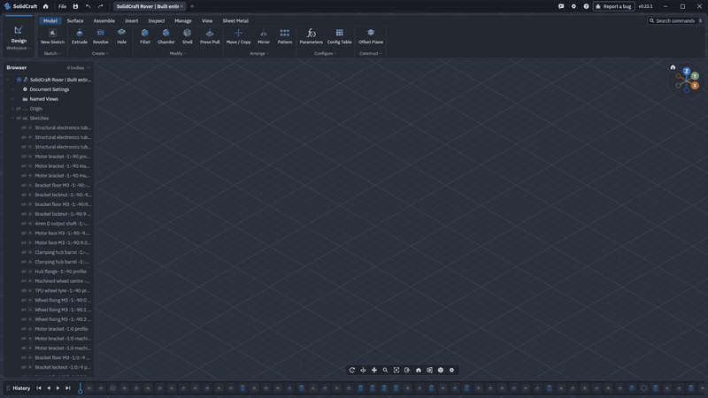

<p align="center">
  
</p>

<h1 align="center">SolidCraft</h1>

<p align="center">
  <strong>Français</strong> · <a href="README.md">English</a>
</p>

<p align="center">
  <strong>Une application de CAO 3D paramétrique open source, écrite entièrement en Rust.</strong><br />
  Esquissez, contraignez et construisez des solides avec une chronologie de fonctions paramétriques. Modifiez une cote
  et regardez votre modèle se reconstruire. Lancez-la sur votre bureau, dans votre navigateur, ou laissez des agents IA
  modéliser grâce au serveur MCP intégré.
</p>

<div align="center">

[![Télécharger pour Windows][badge-windows]][windows-msi]
[![Télécharger pour macOS][badge-macos]][macos-dmg]
[![Télécharger pour Linux][badge-linux]][linux-appimage]
[![Disponible sur le Snap Store][badge-snap]][snap-store]
[![Essayer dans le navigateur][badge-web]][web-app]

</div>

<p align="center">
  <a href="https://solidcraft.io">Site web</a> ·
  <a href="https://github.com/tangency-labs/solidcraft/releases/latest">Téléchargement</a> ·
  <a href="https://coyotte-hue.github.io/solidcraft/app/">Essayer dans le navigateur</a> ·
  <a href="https://coyotte-hue.github.io/solidcraft/">Documentation</a> ·
  <a href="https://discord.gg/FtU4NQNVDH">Discord</a> ·
  <a href="https://github.com/bherbruck/solidcore">SolidCore</a>
</p>

<p align="center">
  <a href="https://github.com/tangency-labs/solidcraft/actions/workflows/ci.yml?query=branch%3Amain"></a>
  <a href="https://github.com/tangency-labs/solidcraft/releases/latest"></a>
  <a href="https://github.com/tangency-labs/solidcraft/releases"></a>
  <a href="LICENSE"></a>
  <a href="https://discord.gg/FtU4NQNVDH"></a>
  <a href="https://github.com/tangency-labs/solidcraft/stargazers"></a>
</p>


*Un boîtier de Raspberry Pi 4 depuis une conception vide : une esquisse cotée avec les paramètres de la carte, extrusion, congé, coque, le rebord arrondi d'un seul geste, une entretoise M2.5 répétée sur le rectangle de perçage de 58 × 49 mm, des découpes de ports, des fentes d'aération, « Pi 4 » gravé en DejaVu Sans Bold et un matériau PETG défini dans la conception, avec sa masse dans Propriétés, puis hauteur 24 → 32 mm dans Paramètres et tout se reconstruit. Lecture ×9. [Vidéo complète](https://github.com/tangency-labs/solidcraft/raw/refs/heads/main/docs/screenshots/demo-0.8.mp4), enregistrée avec le [script de démo](examples/demo/record_ui.sh).*

## Téléchargement

- **Windows :** téléchargez et exécutez l'[installateur][windows-msi].
  Aussi pour PC [ARM64][windows-arm64-msi] et [32 bits][windows-x86-msi], ou en
  [zip portable][windows-portable] qui fonctionne sans installation.
  Avec [WinGet](https://learn.microsoft.com/windows/package-manager/winget/) :
  `winget install bherbruck.SolidCraft`.
- **macOS :** ouvrez l'[image disque][macos-dmg] et glissez SolidCraft dans Applications
  (Apple silicon et Intel).
- **Linux :** téléchargez l'[AppImage][linux-appimage], autorisez son exécution en tant que programme, puis ouvrez-la.
  Ou installez le [.deb][linux-deb] (Ubuntu, Debian, Mint) ou le [.rpm][linux-rpm] (Fedora,
  openSUSE), ou utilisez [Flatpak](https://coyotte-hue.github.io/solidcraft/guide/getting-started.html#linux-flatpak).
  Avec Snap : `sudo snap install solidcraft` ([Snap Store][snap-store], ou le [fichier .snap][linux-snap]).
  Pour ARM64 : [AppImage][linux-arm64-appimage], [.deb][linux-arm64-deb], [.rpm][linux-arm64-rpm].
- **Web :** [essayez dans votre navigateur][web-app], sans rien installer.

Les téléchargements ne sont pas encore signés. Sous Windows, si SmartScreen vous alerte, choisissez **Informations complémentaires**, puis
**Exécuter quand même**. Sous macOS, la première fois, faites un clic droit sur SolidCraft dans Applications et choisissez **Ouvrir**.

Les anciennes versions, les sommes de contrôle et d'autres formats se trouvent sur la [page des versions](https://github.com/tangency-labs/solidcraft/releases).
Les détails d'installation, la mise à niveau depuis des versions antérieures et la compilation à partir des sources sont dans
[Démarrage](https://coyotte-hue.github.io/solidcraft/guide/getting-started.html).

[badge-windows]: https://img.shields.io/badge/Windows-T%C3%A9l%C3%A9charger-0078D6?style=for-the-badge&logo=data%3Aimage%2Fsvg%2Bxml%3Bbase64%2CPHN2ZyB4bWxucz0iaHR0cDovL3d3dy53My5vcmcvMjAwMC9zdmciIHZpZXdCb3g9IjAgMCAyNCAyNCIgZmlsbD0id2hpdGUiPjxwYXRoIGQ9Ik0yIDJoOS41djkuNUgyek0xMi41IDJIMjJ2OS41aC05LjV6TTIgMTIuNWg5LjVWMjJIMnpNMTIuNSAxMi41SDIyVjIyaC05LjV6Ii8%2BPC9zdmc%2B
[badge-macos]: https://img.shields.io/badge/macOS-T%C3%A9l%C3%A9charger-333333?style=for-the-badge&logo=apple&logoColor=white
[badge-linux]: https://img.shields.io/badge/Linux-AppImage-E95420?style=for-the-badge&logo=linux&logoColor=white
[badge-snap]: https://img.shields.io/badge/Snap-Snap_Store-82BEA0?style=for-the-badge&logo=snapcraft&logoColor=white
[badge-web]: https://img.shields.io/badge/Web-Essayer_dans_le_navigateur-2EA44F?style=for-the-badge&logo=data%3Aimage%2Fsvg%2Bxml%3Bbase64%2CPHN2ZyB4bWxucz0iaHR0cDovL3d3dy53My5vcmcvMjAwMC9zdmciIHZpZXdCb3g9IjAgMCAyNCAyNCIgZmlsbD0ibm9uZSIgc3Ryb2tlPSJ3aGl0ZSIgc3Ryb2tlLXdpZHRoPSIyIj48Y2lyY2xlIGN4PSIxMiIgY3k9IjEyIiByPSIxMCIvPjxwYXRoIGQ9Ik0yIDEyaDIwTTEyIDJhMTUgMTUgMCAwIDEgMCAyME0xMiAyYTE1IDE1IDAgMCAwIDAgMjAiLz48L3N2Zz4%3D
[windows-msi]: https://github.com/tangency-labs/solidcraft/releases/latest/download/solidcraft-windows-x64.msi
[windows-arm64-msi]: https://github.com/tangency-labs/solidcraft/releases/latest/download/solidcraft-windows-arm64.msi
[windows-x86-msi]: https://github.com/tangency-labs/solidcraft/releases/latest/download/solidcraft-windows-x86.msi
[windows-portable]: https://github.com/tangency-labs/solidcraft/releases/latest/download/solidcraft-windows-x64-portable.zip
[macos-dmg]: https://github.com/tangency-labs/solidcraft/releases/latest/download/solidcraft-macos-universal.dmg
[linux-appimage]: https://github.com/tangency-labs/solidcraft/releases/latest/download/solidcraft-linux-x86_64.AppImage
[linux-deb]: https://github.com/tangency-labs/solidcraft/releases/latest/download/solidcraft-linux-x86_64.deb
[linux-rpm]: https://github.com/tangency-labs/solidcraft/releases/latest/download/solidcraft-linux-x86_64.rpm
[linux-arm64-appimage]: https://github.com/tangency-labs/solidcraft/releases/latest/download/solidcraft-linux-aarch64.AppImage
[linux-arm64-deb]: https://github.com/tangency-labs/solidcraft/releases/latest/download/solidcraft-linux-aarch64.deb
[linux-arm64-rpm]: https://github.com/tangency-labs/solidcraft/releases/latest/download/solidcraft-linux-aarch64.rpm
[linux-snap]: https://github.com/tangency-labs/solidcraft/releases/latest/download/solidcraft-linux-x86_64.snap
[snap-store]: https://snapcraft.io/solidcraft
[web-app]: https://coyotte-hue.github.io/solidcraft/app/

**Documentation :** le [livre SolidCraft](https://coyotte-hue.github.io/solidcraft/) (guide utilisateur,
guide développeur et référence des commandes ; sources dans [docs/book](docs/book)).

**Communauté :** discutez avec les utilisateurs et les contributeurs sur [Discord](https://discord.gg/FtU4NQNVDH).

**Statut : encore précoce, mais utilisable pour des pièces simples.** 75 des 76 pièces de référence publiques
correspondent à leur volume, aire, centre de masse et boîte englobante calculés analytiquement ou par FreeCAD
([docs/oracle.md](docs/oracle.md)) ; la dernière est un bug suivi.
Ces vérifications n'établissent pas une équivalence géométrique ou de flux de travail complète. Les commandes dont dispose
SolidCraft sont listées par domaine dans [docs/features.md](docs/features.md) ; l'état et les plans sont dans [ROADMAP.md](ROADMAP.md).
Le travail en cours et les bugs connus sont dans les [issues GitHub](https://github.com/tangency-labs/solidcraft/issues),
et l'aide est bienvenue : voir [CONTRIBUTING.md](CONTRIBUTING.md).

## Construit avec SolidCraft

<a href="https://github.com/0xlillith/solidcraft-rover"></a>

*SELENE, un rover scientifique construit entièrement via le serveur MCP de SolidCraft par
[@0xlillith](https://github.com/0xlillith/solidcraft-rover) : 3 323 étapes de chronologie modifiables qui
se reconstruisent sans erreur, rejouées ici à vitesse ×2.
[Vidéo complète](https://github.com/tangency-labs/solidcraft/raw/refs/heads/main/docs/screenshots/rover-build.mp4)
· [télécharger le modèle modifiable](https://github.com/0xlillith/solidcraft-rover/releases/tag/v1.0.0).*

## Ce qui fonctionne

- **Export DXF de la vue courante** via Fichier → Exporter la vue courante en DXF, avec les arêtes cachées
  omises ou en pointillés, l'affichage des emplacements de corps et de la caméra courante. Voir [vue DXF](docs/view-dxf.md).

- **Esquisses** sur les plans d'origine, les plans décalés ou les faces planes : lignes, rectangles, cercles,
  arcs, polygones, fentes, ellipses, splines à points de passage / points de contrôle, coniques et texte ; géométrie de construction,
  projection, rognage, congés et chanfreins, y compris les coins à l'origine.
  Les nouveaux rattachements de face conservent les identités de construction prises en charge et les occurrences choisies ;
  les sources manquantes exposent un flux explicite de réparation du plan. Voir [rattachements de face](docs/face-attachments.md).
  Les splines à points de passage explicitement fermées et les décalages associatifs fermés utilisent une interpolation C2 périodique.
  Les décalages convexes ligne-et-arc pris en charge conservent leur identité quand un décalage intérieur consomme des arcs de coin,
  et les extrusions liées suivent la frontière courante. Rompre l'association fige
  la frontière et laisse les extrusions existantes utilisables.
  Le tracé et la sélection des courbes s'adaptent ensemble au zoom et à l'échelle d'affichage, y compris les petits cercles
  lors d'un ajustement (Fit) et les esquisses dans des composants placés.
- **Contraintes et cotes** résolues par notre propre solveur. Les points que les contraintes fixent par rapport
  à une géométrie connue sont placés exactement par construction (intersections de lieux et décomposition en grappes rigides,
  d'après Owen 1991 et Fudos–Hoffmann 1997) ; Levenberg–Marquardt résout le reste,
  et le rang de son jacobien donne les degrés de liberté restants. Contraintes : coïncidence,
  point sur courbe, horizontal/vertical, parallèle, perpendiculaire, tangente, courbure (G2), égal,
  concentrique, colinéaire, milieu, symétrie, fixe ; cotes linéaires, alignées, horizontales, verticales,
  point-ligne, rayon, diamètre, angle, balayage d'arc, longueur d'arc et longueur de fente
  pilotées par des paramètres. Les modifications qui sur-contraignent sont rejetées ; la géométrie entièrement contrainte devient noire.
  Le glissement résout l'esquisse à chaque image et reconstruit le modèle une seule fois, à la fin du glissement.
  Sélectionnez une ligne ou ses deux extrémités, tapez sa cote et appuyez sur Entrée pour valider en une seule
  étape d'annulation ; avec Dimension d'esquisse, c'est D, clic, saisie, Entrée. Ajuster maintient la géométrie de l'esquisse à l'écart de la palette et des contrôles de navigation.
- **Profils** détectés automatiquement, y compris les régions découpées par des lignes et les trous à l'intérieur des contours.
  Les frontières adaptatives complètes nouvellement capturées conservent leurs identités de source de contour extérieur et de trou
  quand le nombre de segments de spline change. Les frontières partielles ou ambiguës ne sont pas éligibles.
- **Fonctions** sur une chronologie paramétrique : extrusion, révolution, balayage, lissage (loft), congé/chanfrein,
  coque, dépouille, perçages, filetages, répétitions, symétrie, division, combinaison, déplacement et géométrie de construction.
  La chronologie se reconstruit de façon incrémentale ; les fonctions peuvent être modifiées, désactivées, renommées, réordonnées
  et supprimées. La géométrie prise en charge et les limitations actuelles sont décrites dans [ROADMAP.md](ROADMAP.md).
  Les nouvelles révolutions préservent le placement angulaire symétrique et des deux côtés à travers des axes inversés ;
  les anciennes conceptions conservent leur convention enregistrée lors de leur réouverture ou modification.
- **Paramètres et configurations** avec des expressions tenant compte des unités (`2 * width + 5 mm`,
  `angle / 2`), des règles ordonnées, la désactivation de fonctions et des matériaux/apparences de corps par ligne.
- **Assemblages** avec composants imbriqués et occurrences, articulations, études de mouvement, ensembles de contacts,
  interférences et propriétés de masse tenant compte des matériaux. Les transferts de corps enregistrés préservent l'historique de modélisation
  et le placement dans l'espace ; les fils d'esquisse 3D conservent leurs repères de coordonnées à travers les modifications.
- **Tôlerie** avec rebords, ourlets, pliage/dépliage/repliage, découpes de matière, mises à plat,
  poches prismatiques peu profondes conservées, contours DXF exacts en lignes/arcs/cercles et tables de pliage ;
  fonctions et règles pour boîtiers en plastique. La profondeur et le côté des poches survivent au dépliage/repliage et apparaissent
  séparément des contours de trous traversants dans l'aperçu à plat et le DXF.
- **Fichiers** : conteneurs de conception (`.solidcraft`) avec charges de maillage binaires sans perte ;
  le JSON simple reste pris en charge pour l'ouverture, l'enregistrement sous et l'export. À l'ouverture sur ordinateur, une image
  provisoire enregistrée à partir de caches de géométrie « chaude » peut s'afficher pendant la reconstruction qui précède l'édition ; les caches ne
  remplacent jamais la conception paramétrique. Export vers STEP (AP242 avec noms de corps, couleurs et
  composants en assemblages ; faces de révolution en plans, cylindres, cônes, sphères et tores natifs),
  IGES 5.3 (B-reps solides manifold avec noms et couleurs), 3MF, STL (binaire/ASCII) et OBJ, et
  les assemblages avec articulations en URDF pour les simulateurs de robots (docs/urdf.md) ;
  les importations 3MF, STL, OBJ et glTF 2.0 (`.glb`/`.gltf`, son arbre de nœuds comme composants et ses matériaux comme
  apparences) arrivent comme corps maillés (ils s'affichent, se mesurent, se déplacent et s'exportent ; les fonctions solides
  nécessitent des corps B-rep). La commande `mesh.convert` reconstruit les pièces fermées à section constante prises en charge
  en solides paramétriques à faces planes et cylindriques circulaires ;
  import STEP (solides AP203/AP214/AP242, assemblages, unités, noms, couleurs) et import IGES
  (B-reps solides manifold, ou surfaces ajustées et bornées cousues en solides) comme fonction de base
  sur laquelle les fonctions suivantes se construisent — ouvrez un fichier `.step`/`.stp`/`.igs`/`.iges`, insérez-le dans une
  conception, ou déposez-le sur la fenêtre ([docs/step-import.md](docs/step-import.md)) ; les solides FreeCAD
  `.FCStd` et Rhino `.3dm` s'importent de la même manière via
  [cadmpeg](https://github.com/cadmpeg/cadmpeg) dans l'application de bureau et la CLI.
- **Rendu :** les surfaces opaques peuvent utiliser la fraction métallique, la rugosité et l'IOR diélectrique dans la
  vue produit intégrée et les PNG d'aperçu CPU. Les couleurs simples existantes restent prises en charge.
  L'éclairage direct fixe est un aperçu ; HDRI, réfraction et textures ne sont pas implémentés.
  Voir [surfaces opaques](docs/render-opaque-pbr.md).
- **Maillages d'affichage** produits par notre propre planificateur de tessellation : chaque face devient un plan de points (u, v)
  et de triangles qui partage ses nœuds de bord avec ses voisins, de sorte que le maillage est étanche.
  Les facettes respectent la tolérance de corde, l'angle de facette et une longueur de côté maximale, avec des cellules d'au plus 2:1
  le long des directions droites. Les faces délimitées par une boîte et à quatre coins sont maillées en grilles structurées.
  Les faces rognées sont découpées en patchs quadrilatéraux : carrés autour des trous, « papillons » dans les faces
  rondes, tracés « motorcycle » depuis les coins concaves (d'après Lyon et al. 2019). Chaque patch est ensuite maillé
  comme une grille de Coons. Les arêtes d'intersection sont évaluées par la méthode de Newton sur les deux surfaces. Un compute shader
  évalue les plans de toute la scène en une seule passe, avec un repli CPU quand le GPU
  ne peut pas le construire. Planifier et évaluer les 78 corps de référence prend environ 65 ms, soit 50–65×
  plus rapide que le mailleur précédent.
- **Application de bureau** (egui + wgpu) : barre d'outils avec onglets d'espace de travail, navigateur, chronologie, fenêtre 3D avec
  vue d'axes et barre de navigation, outils d'esquisse, boîtes de dialogue de fonctions, palette de commandes, et un canal de contrôle
  JSON Lines pour que les agents et les tests puissent la piloter.
  Les erreurs de fonction et l'aide peuvent ouvrir un brouillon modifiable **Créer une issue** avec le contexte pertinent
  et une capture d'écran facultative vérifiée ; ouvrir GitHub ne soumet pas le rapport.
- **CLI sans interface** `solidcraft-cli` : exécuter des scripts de commandes, mesurer (volume, aire, centre de masse,
  nombre de faces/arêtes/sommets), exporter, générer des captures PNG et rejouer les recettes de référence.
- **Serveur MCP** `solidcraft-cli mcp` : les agents IA modélisent, mesurent et observent les pièces sans interface ou
  dans l'application en cours d'exécution (voir ci-dessous).

## Compiler et exécuter

```sh
cargo run --release -p solidcraft -- --sample          # application de bureau avec une pièce d'exemple
cargo run --release -p solidcraft-cli -- commands      # le registre des commandes
cargo run --release -p solidcraft-cli -- run examples/bracket.json --out bracket.step
cargo run --release -p solidcraft-cli -- snapshot examples/bracket.json --out bracket.png
cargo run --release -p solidcraft-cli -- render examples/render-studio.json --out product.png
cargo run --release -p solidcraft -- part.step          # ouvrir un fichier STEP comme nouvelle conception
cargo run --release -p solidcraft-cli -- eval part.step # mesurer un fichier STEP importé
cargo xtask ci                                          # fmt, clippy, tests, assets, couches, wasm
```

Compilations Windows : `cargo xwin build --release --target x86_64-pc-windows-msvc -p solidcraft`.

Sous Windows et Linux, SolidCraft détecte un SpaceNavigator ou SpaceMouse de 3Dconnexion connecté via son
interface HID multi-axes. Déplacez le chapeau pour panoramiquer et zoomer, inclinez-le ou faites-le pivoter pour tourner la vue 3D.
Pendant l'édition d'une esquisse, le chapeau effectue panoramique et zoom sans changer la vue de l'esquisse. La page
Navigation des préférences possède un interrupteur marche/arrêt et un réglage de vitesse pour la souris 3D. L'application web le prend
aussi en charge, via le navigateur ; Firefox a d'abord besoin d'un réglage 3DxWare (voir
[Démarrage › souris 3D dans le navigateur](docs/book/src/guide/getting-started.md#3d-mouse-in-the-browser)).

Avec 3DxWare sous Windows, SolidCraft suit le profil 3DxWare qui lui est destiné lorsqu'il existe, et
le mode objet de 3DxWare (incliner pour rouler, pivoter pour tourner) jusqu'à ce qu'il existe. Les rotations de molette que
3DxWare génère à partir du mouvement du chapeau sont ignorées, pour que la vue ne zoome pas par paliers quand le chapeau s'incline.

Sous Linux, SolidCraft lit `/dev/hidrawN` directement, donc l'utilisateur connecté doit avoir accès au
périphérique. Une règle udev qui ajoute le tag `uaccess` s'en charge, par exemple
`/etc/udev/rules.d/70-3d-mouse.rules` pour les périphériques avec l'identifiant de fournisseur de 3Dconnexion :

```
SUBSYSTEM=="hidraw", ATTRS{idVendor}=="256f", TAG+="uaccess"
```

Les anciens SpaceNavigator utilisent l'identifiant de fournisseur Logitech `046d` ; ajoutez une règle avec leur identifiant de produit (voir `lsusb`)
au lieu de faire correspondre tous les périphériques Logitech. Rechargez avec `sudo udevadm control --reload && sudo udevadm trigger`, puis rebranchez le périphérique. Le bac à sable Flatpak
n'expose pas les périphériques hidraw, donc la souris 3D n'y fonctionne pour l'instant qu'avec les versions natives.
Les périphériques qui envoient les six axes dans le rapport HID 1 (certains modèles maison le font) sont reconnus à partir de leur
descripteur de rapport, et fonctionnent donc aussi.

Dans le navigateur : `cd apps/solidcraft-web && trunk build --release --public-url ./` (WebGPU, ou
WebGL2 avec `?webgl` ; `?sample` ouvre la pièce d'exemple).

## Scripts

Un script est une liste JSON de commandes, les mêmes que celles exécutées par l'interface :

```json
{"commands": [
  {"command": "sketch.create", "params": {"plane": "XY"}},
  {"command": "sketch.rectangle.two_point", "params": {"p0": [0, 0], "p1": [40, 30]}},
  {"command": "solid.extrude", "params": {"distance": 20}},
  {"command": "solid.fillet", "params": {"edges": [[0, 0, 10]], "radius": 3}}
]}
```

## Agents IA (MCP)

`solidcraft-cli mcp` est un serveur [Model Context Protocol](https://modelcontextprotocol.io) sur
stdio. Sans interface, il exécute sa propre session de conception ; avec `--connect 127.0.0.1:PORT`, il pilote l'application
démarrée avec `solidcraft --control PORT`, ce qui vous permet de regarder l'agent modéliser. Outils :
`list_commands`, `execute`, `batch`, `inspect_design`, `measure`, `body_topology`,
`set_parameter`, `screenshot` (renvoie l'image), `export`, `undo`, `redo`, `new_design`, `open`,
`save`. Les appels d'outils n'accèdent aux fichiers que dans le dossier de la conception ouverte (lorsqu'il se trouve dans votre dossier personnel,
jamais le dossier personnel lui-même ni un dossier caché), le dossier de récupération de SolidCraft et les dossiers indiqués avec
`--allow-path DIR`. Claude Code : `claude mcp add solidcraft -- solidcraft-cli mcp`. Détails, configuration
client et session d'exemple : [docs/mcp.md](docs/mcp.md).

## Architecture

<!-- ANCHOR: architecture -->
| Couche | Crates | Rôle |
|---|---|---|
| L0 | `geom` | vecteurs, plans, profils, maillages et leurs mesures |
| L1 | `sketch`, `kernel`, `render` | solveur de contraintes et profils ; la frontière du noyau B-rep (truck) ; mathématiques de vue et description de scène sans interface |
| L2 | `doc` | paramètres, expressions, la chronologie de fonctions et son évaluation incrémentale |
| L3 | `io` | fichiers de conception, export STL/OBJ/STEP/3MF, fonctions d'import STEP et 3MF/STL/OBJ/glTF |
| L4 | `engine` | la session et le registre des commandes (tout est une commande) |
| L5 | `gpu`, `ui-egui`, `mcp` | évaluation par compute shader des plans de tessellation d'affichage ; le frontal de bureau interchangeable ; le serveur MCP (sans interface ou relié à l'application) |
| apps | `solidcraft`, `solidcraft-cli` | application de bureau, CLI sans interface |
<!-- ANCHOR_END: architecture -->

## Contribuer

Vous venez d'Autodesk Fusion ? SolidCraft utilise des flux de travail CAO paramétrique familiers : esquisses contraintes,
fonctions solides, chronologie modifiable, paramètres et assemblages. Voir la
[feuille de route](ROADMAP.md) pour les opérations prises en charge et les limitations actuelles.

Voir [CONTRIBUTING.md](CONTRIBUTING.md) : comment compiler et tester, la carte du code, les règles de clean-room
et de licence, et où l'aide est la plus recherchée.

## Licence

MIT OR Apache-2.0, au choix. Développé selon les
[règles de contribution clean-room](CLAUDE.md) ; le code et les ressources tiers conservent leurs
licences et attributions documentées.

SolidCraft est indépendant. Son comportement est conçu à partir de documentation publique, de conventions CAO
générales et des retours des utilisateurs. Les tests de référence utilisent des valeurs analytiques et des outils open source.
SolidCraft n'est ni affilié à, ni sponsorisé par, ni approuvé par Autodesk. Autodesk et
Fusion sont des marques d'Autodesk, Inc.
